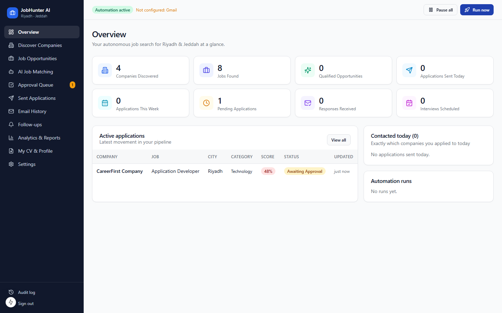
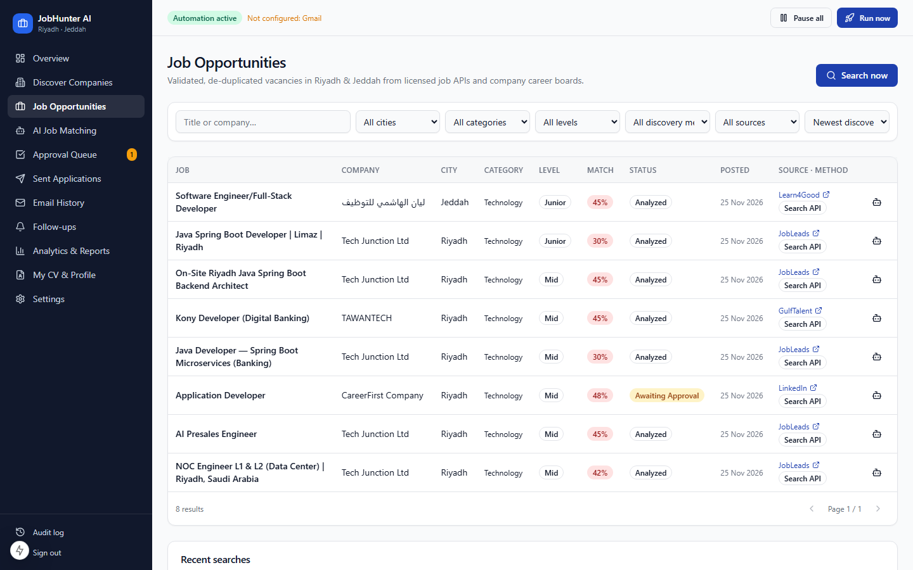
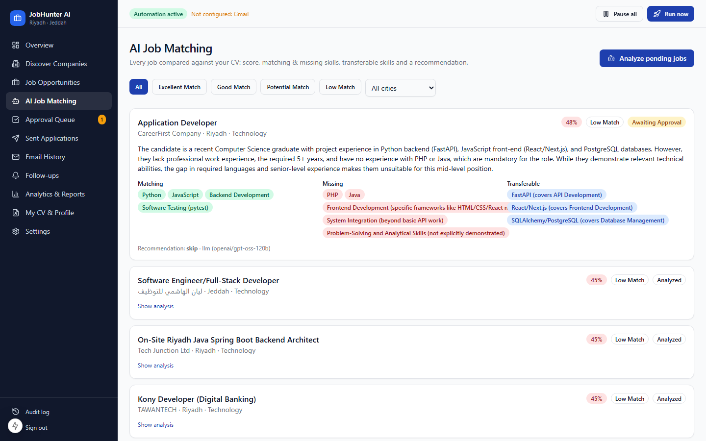
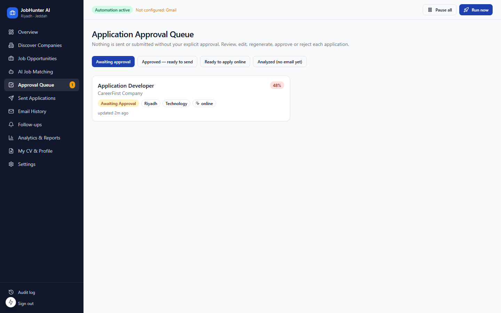
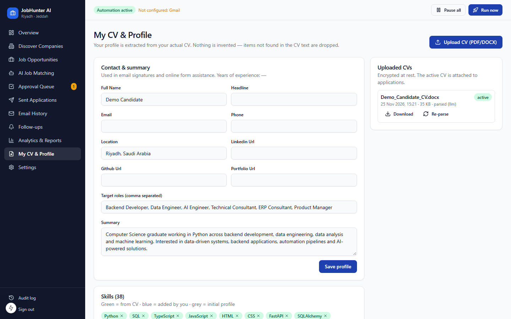

# JobHunter AI

An AI-powered job-hunting assistant for **Riyadh and Jeddah, Saudi Arabia**. It works as a personal recruitment assistant for technology, software engineering, AI, data engineering, IT consulting and product-management roles. It:

- discovers vacancies and the companies behind them;
- matches every job against your **actual CV**;
- drafts a personalized application email for each good match;
- sends applications through **your own Gmail, only after you approve each one**;
- tracks every application on a dashboard.

> **You stay in control.** Automation only finds, analyzes and drafts. Nothing is ever sent or submitted until you approve that specific application, in its exact final wording, and confirm the send.

See [ARCHITECTURE.md](ARCHITECTURE.md) for the design, data model and folder structure.

---

## Features

| Area | What it does |
|---|---|
| **CV analysis** | Upload a PDF or DOCX. AI extracts your skills, education, experience, projects and certifications; anything not literally in your CV text is dropped. Files are encrypted at rest. |
| **Job discovery** | Searches Google for Jobs (via JSearch / SerpAPI) in English and Arabic for 21 target titles plus internships and graduate programs. It also scans company job boards (Greenhouse, Lever, Ashby, Workable, SmartRecruiters) and career pages, which it detects automatically. |
| **Company research** | Reads each company's own website for its description, careers page, LinkedIn page and publicly published recruitment email. An email is kept only if it's on the company's domain and the domain has mail (MX) records. |
| **AI matching** | Scores each job 0–100 against your CV and lists matching, missing and transferable skills, with an explanation and a recommendation. Matches are rated Excellent (80+), Good (65+), Potential (50+) or Low. |
| **Email writing** | A unique, fact-grounded email for each company and role. You can preview, edit, regenerate with instructions, approve or reject it. |
| **Applications** | **Email:** sent via the Gmail API with your CV attached. **Online:** a form assistant pre-fills values from your CV, and you submit on the official site yourself. |
| **Tracking** | 11 statuses with a full history, reply detection, follow-up drafts, an email history and an audit log. |
| **Analytics** | KPI cards and charts (per day, week, city, category; response and interview rates; match scores). A daily report shows exactly which companies you contacted. CSV and Excel export. |
| **Automation** | A daily scheduled run with configurable frequency, cities, categories, experience levels, minimum score, daily cap, sources, and a global pause switch. |

## Screenshots

> Captured from the running application on a separate demo database: a sample CV labelled "Demo Candidate", one real job-discovery run (JSearch, Riyadh and Jeddah) and real AI matching. Gmail was not connected, so nothing was sent.

**Overview.** Pipeline KPIs and the latest applications.



**Job opportunities.** De-duplicated vacancies with city, category, level, match score, status and source.



**AI job matching.** Each job is scored against the CV, with matching, missing and transferable skills and a recommendation.



**Approval queue.** Drafted applications wait here; nothing is sent without explicit approval.



**CV and profile.** The profile is extracted from the uploaded CV, which is encrypted at rest.



---

## Tech stack

- **Backend:** Python, FastAPI, SQLAlchemy 2, Alembic, Pydantic, PostgreSQL (`pg8000`), APScheduler, httpx, BeautifulSoup, pypdf, python-docx, openpyxl.
- **AI:** any OpenAI-compatible API: OpenAI, **Groq (free)** or **Google Gemini (free)**.
- **Integrations:** JSearch (RapidAPI), SerpAPI Google Jobs, Gmail API (OAuth 2.0), and the public Greenhouse, Lever, Ashby, Workable and SmartRecruiters APIs.
- **Frontend:** Next.js 15, React 19, TypeScript, Tailwind CSS, shadcn/ui (Radix), Zustand, Recharts.
- **Security:** JWT authentication, bcrypt passwords, Fernet encryption for CVs and Gmail tokens, audit logging.

## Project structure

```
backend/
  app/
    api/routes/   REST endpoints (auth, CV/profile, companies, jobs, applications, Gmail, insights, automation)
    core/         configuration, database, security, encryption
    models/       SQLAlchemy models (18 tables)
    services/     CV parser, discovery (search APIs, ATS boards, career pages), enrichment,
                  matching, email writer, Gmail, approval workflow, pipeline, scheduler, analytics
  alembic/        database migrations
  tests/          60 pytest tests (external APIs mocked)
frontend/
  src/app/        dashboard pages (overview, companies, jobs, matching, approval queue, applications,
                  email history, follow-ups, analytics, profile, settings, login)
  src/components/ UI components (shadcn/ui-style)
  src/lib/        API client, Zustand stores, types
docker-compose.yml  PostgreSQL + backend + frontend
```

---

## Installation

### Prerequisites
- **Python 3.12+**
- **Node.js 20+**
- **PostgreSQL 16** (or run it with Docker)
- **Git**

### 1. Clone
```bash
git clone <your-repository-url> jobhunter-ai
cd jobhunter-ai
```

### 2. Database
Create a database and user in PostgreSQL:
```sql
CREATE ROLE jobhunter LOGIN PASSWORD 'choose-a-strong-password';
CREATE DATABASE jobhunter OWNER jobhunter ENCODING 'UTF8';
```
Or use Docker: `docker compose up -d db`. That uses the user, password and database `jobhunter`, which is fine for local development only.

### 3. Backend
```bash
cd backend
python -m venv .venv
# Windows: .venv\Scripts\activate     macOS/Linux: source .venv/bin/activate
pip install -r requirements.txt
cp .env.example .env              # Windows: copy .env.example .env
```
Edit `backend/.env`. At minimum set:
- `DATABASE_URL=postgresql+pg8000://jobhunter:<password>@localhost:5432/jobhunter`
- `SECRET_KEY`: generate it with `python -c "import secrets;print(secrets.token_urlsafe(48))"`
- `ENCRYPTION_KEY`: generate it with `python -c "from cryptography.fernet import Fernet;print(Fernet.generate_key().decode())"`

Then:
```bash
alembic upgrade head
uvicorn app.main:app --port 8000
```
API docs: http://localhost:8000/docs

### 4. Frontend
```bash
cd frontend
cp .env.example .env.local        # Windows: copy .env.example .env.local
npm install
npm run dev
```
Open **http://localhost:3000**. The first visit creates your owner account.

### Alternative: everything with Docker
```bash
cp backend/.env.example backend/.env   # then edit it
docker compose up --build
```

---

## Configuration (API keys)

All keys go in `backend/.env` only, never in the frontend or in git. Every variable is documented in [`backend/.env.example`](backend/.env.example).

| Purpose | Variables | Where to get it | Required? |
|---|---|---|---|
| AI (CV extraction, matching, emails) | `OPENAI_API_KEY`, `OPENAI_MODEL`, `OPENAI_BASE_URL` | OpenAI (paid), **Groq** at console.groq.com/keys (free), or **Gemini** at aistudio.google.com/apikey (free) | Recommended. Without it, the system uses deterministic fallbacks, labelled as such. |
| Job search: Google for Jobs | `RAPIDAPI_KEY` | Subscribe to **JSearch** on RapidAPI (free plan available) | At least one of JSearch or SerpAPI |
| Job search: alternative | `SERPAPI_KEY` | serpapi.com (free plan available) | Optional |
| Gmail sending and reply detection | `GOOGLE_CLIENT_ID`, `GOOGLE_CLIENT_SECRET`, `GOOGLE_REDIRECT_URI` | Google Cloud Console (steps below) | Only for email applications |
| Company boards and career pages | (none) | Public APIs and pages | No key needed |

**Free AI example (Groq):**
```
OPENAI_API_KEY=<your Groq key>
OPENAI_MODEL=openai/gpt-oss-120b
OPENAI_BASE_URL=https://api.groq.com/openai/v1
```

**Gmail OAuth setup (one time):**
1. In Google Cloud Console, create a project.
2. Under **APIs & Services → Library**, enable the **Gmail API**.
3. Under **OAuth consent screen**, choose External, add yourself as a test user, and add the scopes `gmail.send` and `gmail.readonly`.
4. Under **Credentials → OAuth client ID**, choose **Web application**, with the redirect URI `http://localhost:8000/api/gmail/callback`.
5. Put the client ID and secret in `backend/.env`. Then, in the dashboard, go to **Settings → Connect Gmail**.

---

## Usage

1. **My CV & Profile:** upload your CV (PDF or DOCX) and review what was extracted.
2. **Settings:** choose cities, categories, experience levels, minimum score, daily limit, schedule and sources. Use **Test OpenAI** to check your AI key.
3. **Run now** (top bar), or wait for the scheduled run. Each run:
   1. searches the job sources and scans company boards;
   2. researches companies;
   3. checks the jobs are still open and removes duplicates;
   4. matches each job against your CV;
   5. drafts emails into the **Approval Queue**;
   6. checks for replies and drafts follow-ups;
   7. writes the daily report.
4. **Approval Queue:** review each application, then edit, regenerate, **Approve** or **Reject** it.
   - **Email applications:** **Send via Gmail**, then confirm with **Send now**. Your CV is attached.
   - **Online applications:** open the form assistant, submit on the company's site yourself, then **Mark as applied**.
5. Track everything in **Sent Applications**, **Email History**, **Follow-ups** and **Analytics & Reports**. Export to CSV or Excel at any time.

**Pause all** in the top bar stops every automated action immediately.

### Job sources
| Source | How jobs are found | Key |
|---|---|---|
| JSearch (Google for Jobs) | Keyword search in English and Arabic, Riyadh and Jeddah | `RAPIDAPI_KEY` |
| SerpAPI Google Jobs | Keyword search | `SERPAPI_KEY` |
| Greenhouse, Lever, Ashby, Workable, SmartRecruiters | Each company's public job-board API | none |
| Company career pages | schema.org `JobPosting` data on the company's own site | none |

Company boards are found automatically: from job links that point into a company's ATS board, and from careers pages found during company research. You can also add them under **Discover Companies → Track a company**. Each board is scanned at most once every 20 hours, and the number per run is capped in Settings.

**Duplicates:** a job counts as a duplicate when it has the same cleaned link, the same source job ID, an apply link matching a known posting, or the same company + title + city within 30 days. The original source is kept, and later sightings are listed under "Also found on".

---

## Safety and compliance

- **Explicit approval for every application.** Every email needs two actions from you for that specific job: **Approve**, then **Send now**.
  - Editing, regenerating, or changing the recipient or method cancels the approval.
  - The *Approved*, *Ready to Apply* and *Applied* statuses can only be reached through the review buttons.
  - There is no auto-send option, and the daily run never sends anything.
  - Follow-up emails also need your own confirmed click.
  - Online forms are never submitted for you.
  - `tests/test_approval_guarantee.py` verifies all of this.
- **No direct scraping of LinkedIn, Indeed, Bayt, Glassdoor and similar sites.** Their listings are reached only through licensed aggregator APIs. Company websites are read politely:
  - `robots.txt` is respected, including its Crawl-delay;
  - requests to the same site are at least 1 second apart;
  - the crawler identifies itself;
  - CAPTCHAs, logins and blocked pages are skipped, never bypassed.
- **No invented data.**
  - Jobs need a real source URL.
  - Emails are kept only if the company publishes them on its own domain.
  - The AI's CV extraction is checked against your CV text.
  - Email drafts may only use CV facts, with a warning if one claims a missing skill.
- **No duplicate applications.** There is one application per job, and sending is blocked if you already applied to that role at that company on another board.
- **Security.**
  - JWT authentication and bcrypt-hashed passwords.
  - Encrypted CVs and Gmail tokens.
  - An audit log of logins, uploads, approvals, sends and settings changes.
  - A server-side daily cap.
  - Secrets live only in `.env`, which git ignores.

---

## Testing

```bash
cd backend
pytest -q
```

There are 60 tests, and external APIs (AI, Gmail, job sources) are mocked. They cover:
- authentication;
- CV parsing and the guard against invented CV data;
- discovery, filtering, deduplication across sources, and Arabic titles;
- ATS board detection, SmartRecruiters, and career-page scanning;
- polite crawling (robots.txt and delays);
- AI matching guards;
- the full approve → send-once workflow and the approval guarantee;
- the daily cap and analytics;
- CSV and Excel exports;
- an end-to-end pipeline run.

To run the tests against PostgreSQL instead of SQLite, set `TEST_DATABASE_URL` to a throwaway database. Frontend type-check: `cd frontend && npm run typecheck`.

## Running the pipeline without the web server

The API process runs the scheduler itself. To run the pipeline from cron or Windows Task Scheduler instead:
```bash
cd backend && python -m scripts.run_pipeline
```
If you do this, set `SCHEDULER_ENABLED=false` so runs don't happen twice.

## Troubleshooting

| Problem | Fix |
|---|---|
| Windows: "An Application Control policy has blocked this file" | Smart App Control is blocking compiled Python extensions. This project uses the pure-Python `pg8000` driver and plain HTTP for the AI. Reinstall SQLAlchemy without C extensions: `set DISABLE_SQLALCHEMY_CEXT=1` and `pip install --force-reinstall --no-binary sqlalchemy sqlalchemy`. |
| "OpenAI account has no credits/quota" | Add credits, or switch to the free Groq or Gemini settings shown above. |
| Jobs search shows "error" | Check `RAPIDAPI_KEY` and that `JSEARCH_PATH=/search-v2`. |
| "Backend not reachable" on the login page | Start the backend on port 8000. |
| Hydration warning mentioning `cz-shortcut-listen` | Caused by the ColorZilla browser extension. It's harmless and already suppressed. |

## API overview

Interactive documentation: http://localhost:8000/docs.

| Area | Endpoints |
|---|---|
| Auth | `POST /api/auth/register` · `POST /api/auth/login` · `GET /api/auth/me` |
| CV/Profile | `POST /api/cv/upload` · `GET /api/cv` · `GET /api/cv/{id}/download` · `POST /api/cv/{id}/reparse` · `GET/PUT /api/profile` · `POST/DELETE /api/profile/skills` |
| Companies | `GET/POST /api/companies` · `PATCH/DELETE /api/companies/{id}` · `POST /api/companies/{id}/enrich` · `POST /api/companies/{id}/scan-board` |
| Jobs & matching | `GET /api/jobs` · `GET /api/jobs/{id}` · `POST /api/jobs/{id}/analyze` · `POST /api/matches/analyze-pending` · `POST /api/discovery/run` · `GET /api/discovery/history` · `GET /api/discovery/sources` |
| Applications | `GET /api/applications` · `GET /api/applications/{id}` · `PATCH /api/applications/{id}[/status]` · `POST /api/applications/{id}/{generate-email,approve,reject,send,mark-applied}` · `GET /api/applications/{id}/form-assist` · `PUT /api/emails/{id}` |
| Email & follow-ups | `GET /api/email-history` · `GET /api/followups` · `POST /api/followups/refresh` · `PUT /api/followups/{id}` · `POST /api/followups/{id}/{draft,send,dismiss}` |
| Gmail | `GET /api/gmail/status` · `GET /api/gmail/auth-url` · `GET /api/gmail/callback` · `POST /api/gmail/disconnect` |
| Insights | `GET /api/analytics/overview` · `GET /api/analytics/charts` · `GET /api/reports/daily` · `POST /api/reports/daily/today` · `GET /api/reports/contacted` · `GET /api/exports/applications.{csv,xlsx}` · `GET /api/audit-logs` |
| Automation | `GET/PUT /api/automation/settings` · `POST /api/automation/{pause,resume,run,check-openai}` · `GET /api/automation/runs` · `GET /api/automation/status` |

---

## License

Released under the [MIT License](LICENSE).
